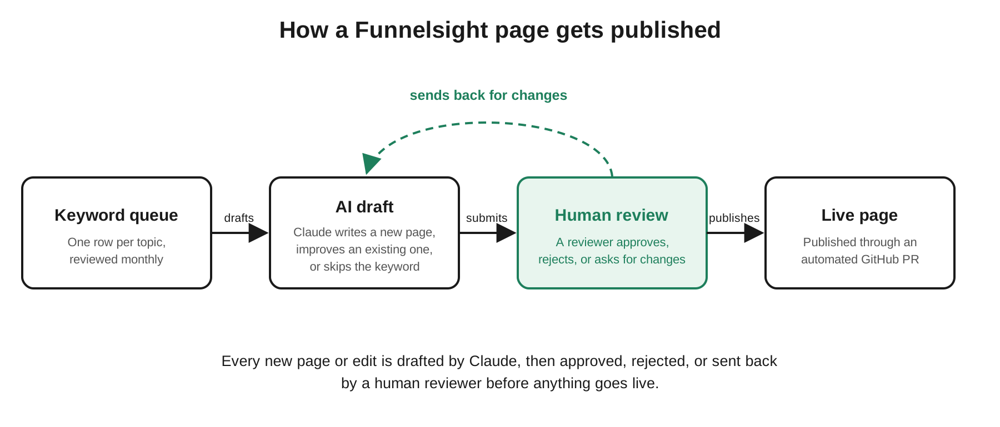

# Hi, I'm Cécile

B2B growth marketer based in Nantes, France. I've owned a revenue target, rebuilt a self-serve acquisition engine and expanded it beyond the US. Most of my work sits where customers judge the product rather than the promise: trials, sign-up flows, onboarding and the handoff to sales.

This GitHub is where I build things myself.

### What I work on

- **Acquisition & conversion:** SEO, paid search, trial and sign-up flows, tests run with the teams behind each channel
- **Self-serve & product-led growth:** trials, usage-based onboarding, sales handoff
- **International growth:** choosing markets, testing before localizing, working with local teams
- **Measurement:** funnel broken down by stage, targets worked back from revenue, pipeline over vanity metrics
- **AI workflows:** AI-assisted content production with human review (see below)

### Featured project

| Repository | Focus |
| :--- | :--- |
| **[`funnelsight-site`](https://github.com/CecileMaindron/funnelsight-site)** | Live marketing site for a fictional B2B SaaS, built to demonstrate an AI-driven SEO content workflow: keyword research → generation → human validation → publication. |

### Writing

I write on Medium about growth, measurement and managing teams through AI: [medium.com/@cmaindron](https://medium.com/@cmaindron)

### Tools

Analytics: GA4, Data Studio, Qlik · Product & research: Pendo, Qualtrics · CRM & automation: Salesforce, Marketo · AI: Claude, n8n

### Contact

French (native) · English (fluent) · German (professional working proficiency)
[linkedin.com/in/cmaindron](https://www.linkedin.com/in/cmaindron)
